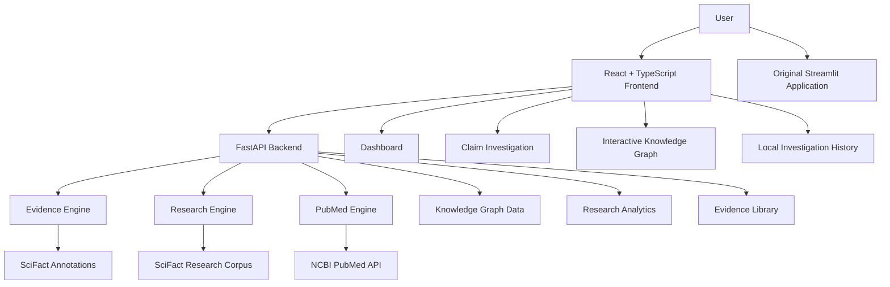
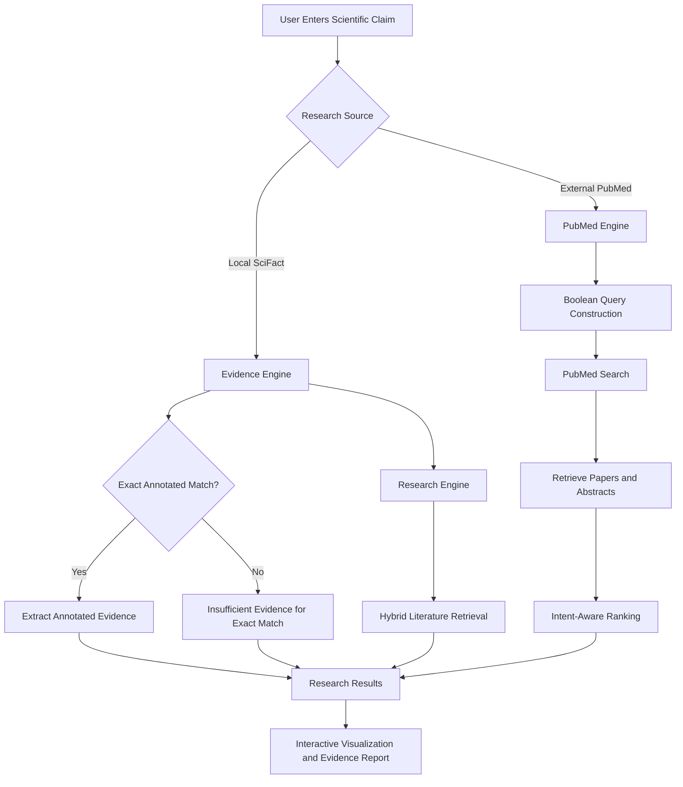
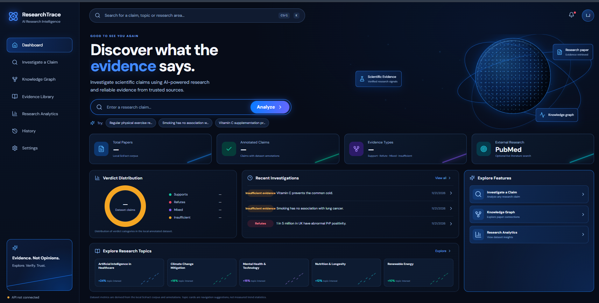
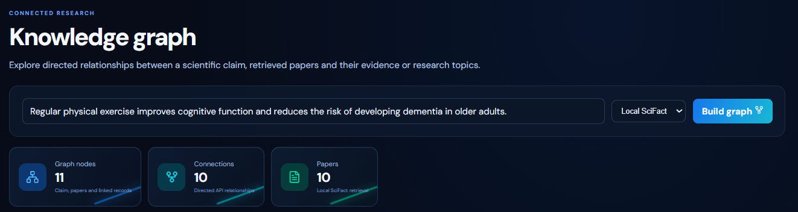
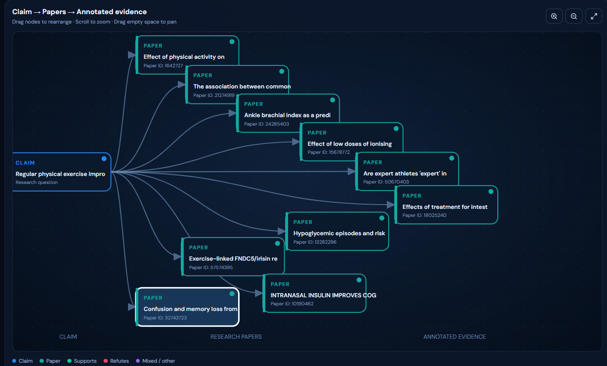
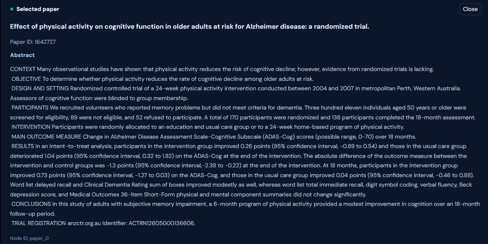

# 🔬 ResearchTrace: AI-Powered Scientific Claim Discovery & Evidence Exploration

[](https://www.python.org/)
[](https://react.dev/)
[](https://fastapi.tiangolo.com/)
[](https://vite.dev/)
[](https://streamlit.io/)
[](https://scifact.allenai.org/)
[](https://pubmed.ncbi.nlm.nih.gov/)
[]()


**ResearchTrace** is an AI-powered scientific claim discovery and evidence exploration platform that helps users investigate scientific claims using curated benchmark annotations and biomedical research literature.

The platform combines the **SciFact scientific verification dataset** with live literature retrieval from **NCBI PubMed**, presenting relevant research papers, annotated evidence, verdicts, and claim-paper relationships through interactive knowledge graphs.

ResearchTrace provides two application interfaces:

- **React + TypeScript + FastAPI:** A modern web application with interactive dashboards, claim investigation, evidence exploration, research analytics, and knowledge graph visualization.
- **Streamlit:** The original research interface, retained as an additional way to explore the underlying research engines.

**Developed by:** Lucky Jain & Shruti Rajak
**Institution:** SVKM's NMIMS, Navi Mumbai

---

## 📑 Table of Contents

1. [Overview & Motivation](#-overview--motivation)
2. [Key Features](#-key-features)
3. [Technology Stack](#-technology-stack)
4. [System Architecture](#-system-architecture)
5. [Project Structure](#-project-structure)
6. [Installation & Setup](#-installation--setup)
7. [Application Interfaces](#-application-interfaces)
8. [Backend API](#-backend-api)
9. [Research Methodology](#-research-methodology)
10. [Dataset & Analytics](#-dataset--analytics)
11. [Example Test Claims](#-example-test-claims)
12. [Scientific Limitations & Disclaimers](#-scientific-limitations--disclaimers)
13. [Authors & Acknowledgements](#-authors--acknowledgements)

---

## 🌟 Overview & Motivation

Scientific misinformation and the rapid growth of biomedical publications make it increasingly difficult to distinguish evidence-based claims from unsupported statements.

Traditional keyword search engines may retrieve papers that share vocabulary with a query without necessarily addressing the actual scientific hypothesis.

ResearchTrace addresses this challenge through a dual-source research architecture.

### 1. Local Benchmark Research — SciFact

Uses the SciFact corpus and its training annotations to:

- Identify exact matches against annotated scientific claims.
- Retrieve supporting and contradicting evidence sentences.
- Determine dataset-based claim verdicts.
- Retrieve related research papers from the local corpus.

### 2. Live Biomedical Literature Research — PubMed

Connects to the NCBI Entrez E-Utilities API to:

- Search biomedical research literature.
- Construct targeted Boolean queries.
- Retrieve paper metadata and abstracts.
- Rank papers according to claim relevance and clinical intent.

### 3. Interactive Research Exploration

Connects claims, papers, evidence sentences, and inferred topics through interactive knowledge graphs.

The platform also provides research analytics, evidence filtering, investigation history, and a centralized dashboard.

---

## 🚀 Key Features

### 1. Scientific Claim Investigation

- Enter natural-language scientific claims.
- Check whether claims exactly match annotated SciFact training records.
- Display dataset-based verdicts: Supports, Refutes, Mixed Evidence, or Insufficient Evidence.
- Retrieve relevant local research papers.
- Retrieve external biomedical literature from PubMed.
- Display annotated evidence sentences when available.

**Important:** Similarity-based retrieval is used to discover relevant literature. Text similarity alone does not establish scientific truth.

### 2. Dual Research Sources

**Local SciFact Research**

- Uses 5,183 corpus papers.
- Uses 807 annotated training claim records in the current loaded dataset.
- Retrieves relevant scientific abstracts.
- Extracts annotated evidence sentences for exact claim matches.

**External PubMed Research**

- Connects to NCBI PubMed through Entrez E-Utilities.
- Retrieves biomedical papers and abstracts.
- Supports targeted literature exploration.
- Uses intent-aware ranking to improve relevance.

### 3. Interactive Knowledge Graph

Provides two graph modes:

- **Local SciFact:** Claim → Research Papers → Annotated Evidence.
- **PubMed:** Claim → Research Papers → Inferred Scientific Topics.

Graph functionality includes:

- Interactive SVG-based visualization.
- Directed relationships between nodes.
- Distinct node types and verdict-based visual distinctions.
- Node selection and information panels.
- Dragging individual nodes.
- Canvas panning.
- Zoom controls.
- Paper and evidence exploration.

### 4. Evidence Library

A centralized interface for exploring annotated evidence records.

Features include:

- Evidence record retrieval.
- Text-based search.
- Verdict filtering.
- Pagination.
- Paper titles and evidence sentence references.

### 5. Research Analytics

Displays descriptive statistics from the SciFact corpus and training annotations.

Includes:

- Total corpus papers.
- Annotated training claims.
- Annotated evidence sentence references.
- Distinct annotation categories.
- Claim verdict distribution.
- Evidence annotation label distribution.
- Papers with the highest number of annotated evidence references.

### 6. Investigation History

- Displays previously investigated claims.
- Shows verdicts and timestamps.
- Allows users to reopen previous investigations.
- Stores recent investigation history locally in the browser.

History is browser-local and is not synchronized through a centralized user account.

### 7. Modern Research Dashboard

The React application includes:

- Centralized research overview.
- Dataset metrics.
- Verdict distribution visualization.
- Recent investigations.
- Research topic exploration.
- Navigation to individual application modules.

### 8. Original Streamlit Interface

The original Streamlit application is retained as an additional research interface.

It provides access to the existing research engines and their original exploration workflow.

---

## 🛠 Technology Stack

| Component                    | Technologies                   |
| ---------------------------- | ------------------------------ |
| Frontend                     | React, TypeScript, Vite        |
| Backend                      | Python, FastAPI, Uvicorn       |
| Original Interface           | Streamlit                      |
| Machine Learning & Retrieval | Scikit-learn, TF-IDF, BM25     |
| Data Processing              | Pandas, NumPy                  |
| Graph Processing             | NetworkX                       |
| Original Graph Visualization | Plotly                         |
| New Graph Visualization      | SVG                            |
| Dataset                      | SciFact                        |
| External Literature          | NCBI PubMed Entrez E-Utilities |
| Development Tools            | VS Code, Git, GitHub           |

---

## 🏗 System Architecture

ResearchTrace uses a frontend-backend architecture for its modern web application while retaining the original Streamlit interface.



### Research Pipeline



---

## 📁 Project Structure

```text
ResearchTrace/
│
├── data/
│   ├── claims_train.jsonl
│   └── corpus.jsonl
│
├── figs/
│
├── frontend/
│   ├── src/
│   │   ├── App.tsx
│   │   ├── main.tsx
│   │   └── styles.css
│   │
│   ├── index.html
│   ├── package.json
│   ├── package-lock.json
│   ├── tsconfig.json
│   └── vite.config.ts
│
├── api.py
├── api_backup.py
├── app.py
├── data_loader.py
├── diagnose_local_relevance.py
├── eval_metrics.py
├── eval_metrics_results.csv
├── evidence_engine.py
├── inspect_data.py
├── pubmed_engine.py
├── research_engine.py
├── show_test_claims.py
├── requirements.txt
├── README.md
└── .gitignore
```

**Important files:**

- `api.py`: FastAPI backend and REST API endpoints.
- `app.py`: Original Streamlit application.
- `evidence_engine.py`: SciFact annotation matching and evidence extraction.
- `research_engine.py`: Local hybrid literature retrieval.
- `pubmed_engine.py`: External PubMed retrieval and ranking.
- `frontend/src/App.tsx`: React application and interactive application modules.
- `frontend/src/styles.css`: Frontend styling.
- `eval_metrics.py`: Evaluation and diagnostic metrics.
- `eval_metrics_results.csv`: Saved evaluation results.

The `.venv`, `node_modules`, generated build files, and Python cache directories are local development artifacts and should not be committed.

---

## 💻 Installation & Setup

### Prerequisites

Install the following:

- Python 3.12 or later.
- Node.js and npm.
- Git.
- Visual Studio Code (recommended).

### 1. Clone the Repository

```powershell
git clone https://github.com/luckyjain04/ResearchTrace.git

cd ResearchTrace
```

### 2. Create and Activate Python Virtual Environment

```powershell
uv venv --python 3.12

.venv\Scripts\Activate.ps1
```

Alternatively, use Python's built-in virtual environment:

```powershell
python -m venv .venv

.venv\Scripts\Activate.ps1
```

### 3. Install Python Dependencies

```powershell
uv pip install -r requirements.txt
```

Alternatively:

```powershell
pip install -r requirements.txt
```

### 4. Install Frontend Dependencies

Open a second PowerShell terminal:

```powershell
cd ResearchTrace\frontend

npm install
```

### 5. Launch the FastAPI Backend

In the first terminal:

```powershell
cd ResearchTrace

uvicorn api:app --reload
```

Backend URL:

`http://127.0.0.1:8000`

Interactive API documentation:

`http://127.0.0.1:8000/docs`

### 6. Launch the React Frontend

In the second terminal:

```powershell
cd ResearchTrace\frontend

npm run dev
```

Frontend URL:

`http://localhost:5173`

Keep both terminals running while using the React application.

### 7. Launch the Original Streamlit Application (Optional)

To use the original interface, open another terminal:

```powershell
cd ResearchTrace

streamlit run app.py
```

Streamlit URL:

`http://localhost:8501`

The Streamlit application is independent of the React frontend and can be launched separately.

---

## 🖥 Application Interfaces

### React + FastAPI Application

The modern web application provides the following modules:

| Module              | Functionality                                      |
| ------------------- | -------------------------------------------------- |
| Dashboard           | Research overview and dataset statistics           |
| Investigate a Claim | Scientific claim investigation and evidence report |
| Knowledge Graph     | Interactive Local SciFact and PubMed graphs        |
| Evidence Library    | Search, filter, and browse annotated evidence      |
| Research Analytics  | Dataset statistics and evidence distribution       |
| History             | Previously investigated claims                     |
| Settings            | Application settings interface                     |

### Backend API Endpoints

The FastAPI backend currently exposes the following endpoints:

| Method | Endpoint         | Description                                 |
| ------ | ---------------- | ------------------------------------------- |
| GET    | `/api/health`    | Backend health check                        |
| GET    | `/api/dashboard` | Dashboard data                              |
| POST   | `/api/analyze`   | Analyze a scientific claim                  |
| POST   | `/api/graph`     | Generate Local SciFact or PubMed graph data |
| GET    | `/api/evidence`  | Retrieve and filter evidence records        |
| GET    | `/api/analytics` | Retrieve dataset analytics                  |

Interactive endpoint testing is available through:

`http://127.0.0.1:8000/docs`

---

## 🔍 Research Methodology

### 1. SciFact Evidence Evaluation

The evidence engine uses the SciFact training annotations to determine whether a claim has an exact annotated match.

The engine:

1. Normalizes claim text.
2. Checks for an exact annotated training claim.
3. Retrieves associated paper identifiers.
4. Resolves annotated evidence sentence indices.
5. Extracts supporting or contradicting annotations.
6. Determines the dataset-based verdict.

Supported verdict categories:

- `SUPPORTS`
- `REFUTES`
- `MIXED EVIDENCE`
- `INSUFFICIENT EVIDENCE`

An unmatched claim receives an insufficient-evidence verdict in the exact-match evaluation path. Related papers can still be retrieved for exploration.

### 2. Hybrid Local Research Retrieval

The local research engine uses multiple text representations and ranking techniques to retrieve relevant papers.

Document representations include:

- Word-level TF-IDF features.
- Character-level TF-IDF features.
- Title and abstract representations.
- Expanded scientific concepts.
- Lexical BM25 scoring.
- Scientific topic and term-coverage signals.

The documented hybrid ranking formula is:

[
\begin{aligned}
S(d,q) =;&0.24,TFIDF\_{Title}
+0.22,TFIDF\_{Abstract}\\
&+0.10,TFIDF\_{Title}^{Expanded}
+0.08,TFIDF\_{Abstract}^{Expanded}\\
&+0.05,TFIDF\_{Char}
+0.13,BM25\\
&+0.13,Score\_{Topic}
+0.05,Coverage\_{Terms}
\end{aligned}
]

Here, (S(d,q)) represents the retrieval relevance score for document (d) and query (q).

**Note:** Retrieval scores represent textual relevance, not scientific truth or calibrated probabilities.

### 3. Scientific Concept Matching

The research engine incorporates domain-specific concept dictionaries and phrase matching to improve retrieval.

Examples include:

- Creatine and performance.
- Cognition and neurological function.
- Gut microbiome and health.
- Vitamins and micronutrients.
- Pathology and disease.

Concept expansion helps retrieve papers that use different scientific terminology for related concepts.

### 4. PubMed Literature Retrieval

The PubMed engine uses NCBI Entrez E-Utilities.

Its retrieval process includes:

1. Scientific concept and synonym detection.
2. Boolean query construction.
3. PubMed ESearch for identifying article records.
4. PubMed EFetch for retrieving article metadata.
5. XML parsing and abstract extraction.
6. Relevance ranking based on claim-related concepts and clinical intent.

### 5. Clinical Intent-Aware Ranking

The PubMed ranking system considers clinical intent such as:

- Prevention.
- Treatment.
- Duration.
- Severity.
- Safety.
- Performance.

For example, a claim about preventing the common cold should not automatically treat research about reducing cold duration as direct evidence of prevention.

### 6. Knowledge Graph Construction

ResearchTrace generates two graph types.

**Local SciFact Graph**

- Central claim node.
- Retrieved research paper nodes.
- Annotated evidence nodes when available.
- Directed claim-paper-evidence relationships.

**PubMed Graph**

- Central claim node.
- Retrieved PubMed paper nodes.
- Inferred scientific topic nodes.
- Directed relationships between claims, papers, and topics.

PubMed topic labels are inferred from retrieved paper text. They should not be interpreted as independently verified scientific findings.

---

## 📊 Dataset & Analytics

ResearchTrace uses the SciFact dataset, which contains scientific claims, paper abstracts, and evidence annotations.

### Current Dataset Statistics

| Metric                                 | Count |
| -------------------------------------- | ----: |
| Corpus papers                          | 5,183 |
| Annotated training claims              |   807 |
| Annotated evidence sentence references | 1,023 |
| Distinct annotation categories         |     2 |

### Claim Verdict Distribution

| Verdict               | Count |
| --------------------- | ----: |
| Supports              |   331 |
| Refutes               |   173 |
| Mixed Evidence        |     0 |
| Insufficient Evidence |   303 |

### Evidence Annotation Distribution

| Annotation | Count |
| ---------- | ----: |
| SUPPORT    |   614 |
| CONTRADICT |   341 |

These figures represent the current loaded SciFact training annotations and corpus records.

The verdict distribution is a dataset-level descriptive statistic. It is not a measurement of model accuracy, live application usage, or scientific consensus.

### Evaluation

The repository includes:

- `eval_metrics.py`
- `eval_metrics_results.csv`

These files contain the project's evaluation implementation and saved evaluation results.

Evaluation metrics should be interpreted according to their respective benchmark splits, evaluation methodology, and definitions.

---

## 🧪 Example Test Claims

Use the following claims to explore different ResearchTrace workflows.

### 1. Exact SciFact Annotation Tests

| Target Verdict        | Claim                                                                                                 |
| --------------------- | ----------------------------------------------------------------------------------------------------- |
| Supports              | `32% of liver transplantation programs required patients to discontinue methadone treatment in 2001.` |
| Refutes               | `1 in 5 million in UK have abnormal PrP positivity.`                                                  |
| Insufficient Evidence | `0-dimensional biomaterials lack inductive properties.`                                               |

These examples are intended for testing the exact-match SciFact annotation workflow.

### 2. General Biomedical Research Tests

**Vitamin C and Common Cold**

`Vitamin C prevents the common cold.`

Explore related literature and observe how the system handles an unmatched claim.

**Creatine and Brain Function**

`Creatine supplementation improves cognitive performance and memory.`

Explore related biomedical research papers.

**Gut Microbiome and Mental Health**

`The gut microbiome influences mood, depression, and anxiety via the gut-brain axis.`

Explore literature and inferred topic relationships.

---

## ⚠️ Scientific Limitations & Disclaimers

1. **Dataset-dependent verdicts:** Local SciFact verdicts reflect the annotations available in the training dataset. They should not be interpreted as absolute scientific truth.

2. **Exact matching:** A claim without an exact annotated training match may receive an insufficient-evidence verdict even when related scientific literature exists.

3. **Text similarity is not evidence stance:** A high retrieval similarity score does not mean that a paper supports a claim. Retrieved papers may support, contradict, or simply discuss related topics.

4. **PubMed retrieval is not automatic verification:** Retrieved papers are provided for literature exploration. Their presence does not establish that they support or refute the investigated claim.

5. **Inferred topics:** Topics shown in PubMed knowledge graphs are inferred from paper text and are not independently verified findings.

6. **Clinical interpretation:** ResearchTrace is an academic research exploration tool, not a medical diagnostic system or substitute for professional medical advice.

7. **Evidence quality:** Proper scientific interpretation requires consideration of study design, sample size, dosage, population, bias, replication, and the strength of available evidence.

---
## Application Screenshots

### 1. Main Dashboard



### 2. Knowledge Graph — Research Connections



### 3. Knowledge Graph — Alternative View



### 4. Knowledge Graph — Additional Results



## 👥 Authors & Acknowledgements

**Lucky Jain**
Research, Interface Engineering & Engine Development

**Shruti Rajak**
Research, Engine Development & Interface Engineering

**Institution:**
SVKM's NMIMS (Narsee Monjee Institute of Management Studies), Navi Mumbai Campus.

### Research & Data Acknowledgements

- [SciFact – Allen Institute for AI](https://scifact.allenai.org/)
- [NCBI PubMed](https://pubmed.ncbi.nlm.nih.gov/)
- [NCBI Entrez Programming Utilities](https://www.ncbi.nlm.nih.gov/books/NBK25501/)

---

**Built with Python, FastAPI, React, TypeScript, Streamlit, SciFact, NCBI PubMed, Scikit-learn, NetworkX, and Plotly.**

**ResearchTrace — Connecting Scientific Claims with Research Evidence.**
